 
 

  
  &nbsp;&nbsp;
  

  <strong>Backend Engineer</strong> crafting reliable APIs, clean architecture, and scalable systems for modern products.

 

 
 

<!-- Customize badges to match your real stack -->

  
  
  
  
  
  
  
  

 

Available for freelance &amp; outsource collaboration worldwide.

