<picture>
  <source media="(prefers-color-scheme: light)" srcset="./assets/hero.svg" />
  <source media="(prefers-color-scheme: dark)" srcset="./assets/hero-crimson.svg" />
  
</picture>

  

  <a href="https://www.linkedin.com/in/minh-hy-ph%E1%BA%A1m-bb28a5202/">
    <picture>
      <source media="(prefers-color-scheme: light)" srcset="./assets/btn-linkedin.svg" />
      <source media="(prefers-color-scheme: dark)" srcset="./assets/btn-linkedin-crimson.svg" />
      
    </picture>
  </a>
  &nbsp;&nbsp;
  <a href="mailto:minhhy191@gmail.com">
    <picture>
      <source media="(prefers-color-scheme: light)" srcset="./assets/btn-email.svg" />
      <source media="(prefers-color-scheme: dark)" srcset="./assets/btn-email-crimson.svg" />
      
    </picture>
  </a>

  <strong>Backend Engineer</strong> crafting reliable APIs, clean architecture, and scalable systems for modern products.

<picture>
  <source media="(prefers-color-scheme: light)" srcset="./assets/divider.svg" />
  <source media="(prefers-color-scheme: dark)" srcset="./assets/divider-crimson.svg" />
  
</picture>

 

<picture>
  <source media="(prefers-color-scheme: light)" srcset="./assets/bento.svg" />
  <source media="(prefers-color-scheme: dark)" srcset="./assets/bento-crimson.svg" />
  
</picture>

 
 

<!-- Customize badges to match your real stack -->

  <picture>
    <source media="(prefers-color-scheme: light)" srcset="https://img.shields.io/badge/Go-09090B?style=for-the-badge&logo=go&logoColor=FFFFFF" />
    
  </picture>
  <picture>
    <source media="(prefers-color-scheme: light)" srcset="https://img.shields.io/badge/TypeScript-09090B?style=for-the-badge&logo=typescript&logoColor=FFFFFF" />
    
  </picture>
  <picture>
    <source media="(prefers-color-scheme: light)" srcset="https://img.shields.io/badge/Node.js-09090B?style=for-the-badge&logo=nodedotjs&logoColor=FFFFFF" />
    
  </picture>
  <picture>
    <source media="(prefers-color-scheme: light)" srcset="https://img.shields.io/badge/Python-09090B?style=for-the-badge&logo=python&logoColor=FFFFFF" />
    
  </picture>
  <picture>
    <source media="(prefers-color-scheme: light)" srcset="https://img.shields.io/badge/PostgreSQL-09090B?style=for-the-badge&logo=postgresql&logoColor=FFFFFF" />
    
  </picture>
  <picture>
    <source media="(prefers-color-scheme: light)" srcset="https://img.shields.io/badge/Redis-09090B?style=for-the-badge&logo=redis&logoColor=FFFFFF" />
    
  </picture>
  <picture>
    <source media="(prefers-color-scheme: light)" srcset="https://img.shields.io/badge/Docker-09090B?style=for-the-badge&logo=docker&logoColor=FFFFFF" />
    
  </picture>
  <picture>
    <source media="(prefers-color-scheme: light)" srcset="https://img.shields.io/badge/Linux-09090B?style=for-the-badge&logo=linux&logoColor=FFFFFF" />
    
  </picture>

 

Available for freelance &amp; outsource collaboration worldwide.

