 
 

  
  &nbsp;&nbsp;
  

  <strong>Backend Engineer</strong> crafting reliable APIs, clean architecture, and scalable systems. 
  <em>Kỹ sư Backend chuyên xây dựng hệ thống API ổn định, kiến trúc sạch và dễ mở rộng — nhận dự án freelance &amp; outsource.</em>

 

 
 

<!-- Thay đổi danh sách icon theo đúng Tech Stack thực tế của bạn (https://skillicons.dev) -->

  

 

Available for freelance &amp; outsource collaboration · Sẵn sàng trao đổi và hợp tác dự án

